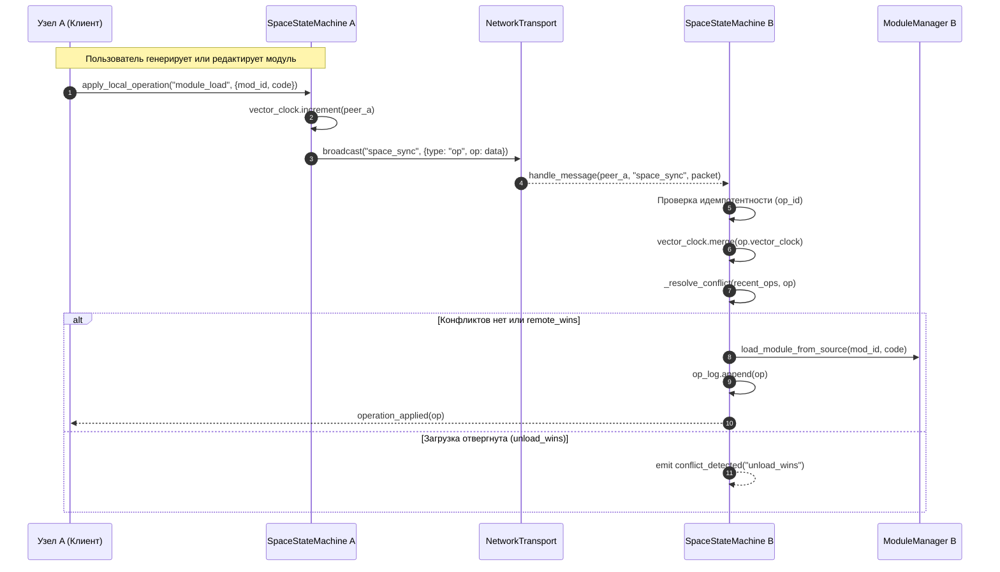

# UniCORE Architecture Blueprint

## 1. Vision & Core Philosophy

**UniCORE («Универсальное ядро»)** — это открытая расширяемая среда, в которую встроен автономный ИИ-Ассистент (**Агент**). Агент способен на лету (в runtime) синтезировать, валидировать и монтировать функциональные **Модули** по запросу пользователя.

### Фундаментальный принцип:
* **Ядро (Core)** — неизменяемо. Стерильно. Не навязывает жестких физических констант (скорость света, вектор гравитации и т.д.). Отвечает только за 3D-пространство, шину событий и жизненный цикл модулей.
* **Модули (Modules)** — полностью изменяемы. Базовая функциональность (пол, локомоция/полет) реализована в виде **предустановленных модулей** (`builtin`), которые пользователь может модифицировать или отключить.
* **Параметры (Parameters)** — совокупный снимок состояния Пространства (активные модули + геометрия + настройки) для локального сохранения и будущего сетевого обмена.

---

## 2. Технологический стек

* **Базовый движок:** Godot 4.x (Standard Edition, GDScript)
* **Язык рантайм-модулей:** GDScript (инъекция через `GDScript.new()` / `reload()`)
* **Интеллект Агента:**
  1. *Фаза 1 (Старт):* Универсальный провайдер (API-ключи: Gemini / OpenAI / OpenRouter + локальная Ollama).
  2. *Фаза 2 (P2P Сеть):* **Семантический P2P-кэш модулей** (готовый код скачивается мгновенно без обращения к LLM) + распределенный рой вычислений (распределение задач по мощности железа и безопасные P2P-прокси ключей).
* **Интерфейс Агента:** Fluid Orb Overlay (динамическая переливающаяся сфера состояний в стиле ChatGPT Voice: Idle, Listening, Thinking/Compiling, Error).

---

## 3. Структура проекта

```text
c:\dev\UniCORE\
├── project.godot               # Конфигурация проекта Godot 4
├── ARCHITECTURE.md             # Настоящий документ (единый источник правды)
├── core/                       # НЕИЗМЕНЯЕМОЕ ЯДРО
│   ├── engine.gd               # Главная точка входа и цикл Ядра
│   ├── event_bus.gd            # Шина сообщений (декуплинг модулей)
│   ├── module_manager.gd       # Монтирование, валидация и компиляция модулей
│   ├── space_manager.gd        # Сериализация и переключение Пространств
│   ├── space_viewport.gd       # Базовая 3D-сцена и отрисовка пустоты
│   ├── input_mapper.gd         # Диспетчер биндов клавиш и реестр действий
│   ├── semantic_cache.gd       # Локальный семантический индекс и ранжирование
│   ├── stopwords.gd            # Стоп-слова (RU/EN) и токенизация
│   └── net/                    # СЕТЕВОЙ СЛОЙ (P2P FOUNDATION)
│       ├── network_transport.gd# ENet транспорт и логические каналы
│       ├── lan_discovery.gd    # UDP широковещательное обнаружение
│       ├── module_sharing.gd   # P2P обмен модулями с SHA-256 и CodeValidator
│       ├── space_sync.gd       # Синхронизация снимков и состояний пространств
│       └── cache_sync.gd       # P2P распределенный поиск и синхронизация кэша
├── modules/
│   ├── builtin/                # Предустановленные модули (можно заменять)
│   │   ├── ground_plane.gd     # Нулевая плоскость мира
│   │   └── avatar_locomotion.gd# Камера, ходьба (WASD) и свободный полет
│   └── user/                   # Сгенерированные или кастомные модули
├── agent/                      # ЛОГИКА АГЕНТА
│   ├── agent_brain.gd          # Оркестратор запросов и Self-Repair Loop
│   ├── code_validator.gd       # Проверка синтаксиса и безопасности GDScript
│   ├── conversation_memory.gd  # Контекстная память и история диалога
│   └── providers/              # Клиенты к LLM (API / Local)
└── ui/                         # ИНТЕРФЕЙС ПОЛЬЗОВАТЕЛЯ
    ├── hud/                    # Верхний кибер-HUD (TopBar с LED индикатором сети)
    ├── menu/                   # Системное меню (MainMenu с вкладкой Сеть)
    ├── module_gallery/         # Галерея и файловый менеджер модулей
    ├── led_indicator/          # Переливающийся Detroit LED-орб
    ├── analysis_drawer/        # Панель диагностики и инспектор кода
    └── prompt_bar/             # Строка ввода команд
```

---

## 4. Контракт Модуля (Module Lifecycle)

Каждый модуль обязан наследоваться от базового интерфейса или соответствовать контракту:
```gdscript
class_name UniCoreModule
extends Node

# Сигнал регистрации в шине событий
signal module_ready(module_name: String)

func get_module_id() -> String:
    return "module_unique_id"

func initialize(core_context: Dictionary) -> void:
    # Инициализация при монтировании в Ядро
    pass

func cleanup() -> void:
    # Корректное освобождение ресурсов при выгрузке
    pass
```

---

## 5. Перспективы (Architectural Hooks)
1. **VR:** Поддержка OpenXR через абстрагированные ноды ввода.
2. **Multiplayer:** Синхронизация состояний и P2P-обмен «Параметрами».
3. **P2P Swarm:** Децентрализованный обмен вычислениями и кэшированными модулями.

---

## 6. Сетевая Архитектура и P2P Взаимодействие (Network Layer Architecture)

Сетевая подсистема UniCORE спроектирована по модульному принципу без блокировки основного потока рендеринга и без жесткой привязки к конкретным сценам:

### 6.1. Абстрактный транспорт (`core/net/network_transport.gd`)
* Построен поверх `ENetMultiplayerPeer`.
* Поддерживает режимы хоста (`host_session(port)`) и клиента (`join_session(address, port)`).
* Внутренняя бинарная сериализация пакетов через `var_to_bytes` / `bytes_to_var` с сохранением типов `Dictionary`, `Vector3`, `Array` и базовых типов.
* **Многоканальность**:
  * `"module_share"` — обмен исходным кодом модулей и предложениями.
  * `"space_sync"` — репликация снимков пространств и состояний нод.
  * `"chat"` — текстовые сообщения между пирами.
  * `"discovery"` — служебные объявления.
  * `"heartbeat"` — пинг каждые 5 сек с измерением RTT latency и автоотключением при таймауте >15 сек.

### 6.2. Автоматическое обнаружение в локальной сети (`core/net/lan_discovery.gd`)
* Работает через бессерверный UDP Broadcast (`PacketPeerUDP`) на порту 7778.
* Регулярно передает сигнатуру `{"type": "unicore_announce", "version": "0.3.0", "name": <space_name>, "port": 7777, "modules_count": N, "timestamp": unix_time}`.
* Автоматическая очистка устаревших узлов при отсутствии анонсов >10 сек (`peer_lost`).

### 6.3. Протокол P2P обмена модулями (`core/net/module_sharing.gd`)
* **Двухфазный протокол подтверждения**: `offer` -> `accept` / `reject` -> `request` -> `data` (с SHA-256 и исходным кодом) -> `verify & import`.
* **Безопасность первого уровня**: Каждый входящий модуль проходит через `CodeValidator.validate_script_source()` перед сохранением на диск. Любые вызовы `OS.execute`, системные пути или нарушения синтаксиса блокируются.
* **Проверка целостности SHA-256**: Вычисление криптографического хэша через `HashingContext.HASH_SHA256` до отправки и после получения. Несоответствие приводит к немедленному отклонению.
* **Квота размера**: Жесткий лимит 64 KB (`MAX_MODULE_SIZE_BYTES = 65536`) для защиты от abuse.
* **Управление доступом**: Поддержка белых и черных списков пиров (`whitelist` / `blacklist`).
* Автоматический импорт верифицированного модуля в `ModuleLibrary`.

### 6.4. Синхронизация Пространств (`core/net/space_sync.gd`)
* Передача и применение снимков пространств через сериализацию `SpaceManager.serialize()`.
* Трансляция динамических изменений состояний (`module_state_change`: загрузка, выгрузка, изменение конфигурации).

### 6.5. Пользовательский интерфейс и HUD интеграция
* **TopBar LED-индикатор**: отображение сетевого статуса (Offline, Hosting, Connected, Syncing) и счетчика подключенных узлов. Клик по индикатору открывает сетевой интерфейс.
* **Вкладка «Сеть» в MainMenu**:
  * Управление сессией: создание хоста, подключение по IP/порту, отключение.
  * Список обнаруженных LAN-узлов в реальном времени с кнопками прямого подключения.
  * Список подключенных участников сессии с возможностью отправки модулей.
  * Панель входящих предложений модулей с кнопками «Принять» / «Отклонить».
* **Настройки сети в SettingsManager**: персистентное сохранение сетевых параметров (`auto_discovery`, `share_modules`, `host_port: 7777`, `discovery_port: 7778`, `player_name`, `max_module_size_kb: 64`).

---

## 7. Разграничение зон ответственности (Core/Backend vs UI/Design System)

Для параллельной разработки без взаимных конфликтов в коде проект разделен на две изолированные сферы:

### 7.1. Зона UI и Дизайна (`ui/`, `assets/`) — Чат Дизайна
* **Полная юрисдикция**:
  * `res://ui/theme/` (система токенов `design_tokens.gd`, базовые компоненты `glass_panel.gd`, тема `cyber_theme.gd`).
  * `res://ui/shaders/` (шейдеры стекла `liquid_glass.gdshader`, сетки `grid_canvas.gdshader`, будущие шейдеры оверлеев).
  * `res://ui/welcome_screen/` (титульный экран и начальное меню).
  * `res://ui/agent_orb/` (интерактивный оверлей Сферы Агента).
  * Визуальная верстка диалогов, карточек и панелей (включая визуал `Input Mapper`).
  * Типографика, SVG-иконки, цветовые палитры и кинетика микро-анимаций.

### 7.2. Зона Ядра, Сети и Агента (`core/`, `agent/`) — Системный Чат
* **Полная юрисдикция**:
  * `res://core/` (жизненный цикл модулей, `space_manager.gd`, `module_library.gd`).
  * `res://core/net/` (сетевой транспорт, LAN discovery, модуль-шеринг, синхронизация пространств).
  * `res://agent/` (LLM API, провайдеры, контекстная память, цикл Self-Repair, `code_validator.gd`).
  * Бэкенд диспетчера управления/биндов (`SettingsManager` input-секция, сохранение в `user://settings.json`).
  * Сквозные автоматизированные тесты ядра в `res://tests/`, сборка `.exe` и целостность движка.

### 7.3. Контракт Сопряжения (Decoupled Integration Protocol)
* **Шина `EventBus`**: модули UI подписываются на сигналы шины (статусы агента, события сети, смена пространств) без прямого доступа к приватным полям бэкенда.
* **Фасад `SettingsManager`**: интерфейс обращается к публичным методам чтения/записи настроек.
* **Точка сборки `res://core/space_viewport.gd`**: новые визуальные слои (Title/Welcome Screen, Fluid Orb Overlay) монтируются как изолированные узлы-компоненты.

---

## 8. Децентрализованный Семантический Кэш Модулей (P2P Semantic Cache Architecture)

Подсистема семантического кэша позволяет находить и монтировать проверенные модули мгновенно (в течение 1–5 миллисекунд), без расхода токенов LLM и независимо от доступности облачных API.

### 8.1. Семантический движок без внешних ML-зависимостей (`core/semantic_cache.gd` и `core/stopwords.gd`)
* **Токенизация и фильтрация шума**: Модуль `Stopwords` содержит фильтры для русского (43 стоп-слова) и английского (38 стоп-слов) языков, нормализует регистр и отсекает служебные символы.
* **Fuzzy n-gram сходство**: Реализован алгоритм сходства n-грамм (по умолчанию триграмм) по формуле Серенсена — Дайса:
  $$\text{Similarity}(A, B) = \frac{2 \cdot |A \cap B|}{|A| + |B|}$$
  позволяющий устойчиво сопоставлять словоформы, опечатки и склонения.
* **Композитная функция релевантности**:
  $$\text{Score} = 0.4 \cdot S_{\text{keywords}} + 0.3 \cdot S_{\text{tags}} + 0.2 \cdot S_{\text{ngram}} + 0.1 \cdot R_{\text{reputation}}$$
  где:
  * $S_{\text{keywords}}$ — доля совпадения токенов запроса с извлеченными ключевыми словами модуля;
  * $S_{\text{tags}}$ — доля совпадения токенов запроса с тегами модуля;
  * $S_{\text{ngram}}$ — сходство триграмм запроса с описанием и именем модуля;
  * $R_{\text{reputation}}$ — репутация модуля ($0.0 \dots 1.0$), динамически возрастающая при каждом успешном использовании (`+0.02` за вызов).
* **Автоматический парсинг метаданных**: Метод `SemanticCache.parse_metadata_from_code()` извлекает структурированные данные из комментариев в коде модуля:
  ```gdscript
  ## Name: Огненный шар
  ## Description: Создает летящую сферу огня с физическим уроном
  ## Tags: spawner, 3d, fx, weapon
  ```
* **Персистентность**: Индекс сохраняется в формате JSON по пути `user://semantic_cache.json`.

### 8.2. Каскадный алгоритм разрешения модулей в AgentBrain
При вводе пользователем промпта `AgentBrain` опрашивает источники по строгому каскадному протоколу:
1. **Module Registry Templates**: Проверка встроенных готовых шаблонов (высокий порог сходства `0.75`).
2. **Local SemanticCache**: Локальный поиск по семантическому индексу. При обнаружении подходящего модуля (`score >= 0.35`) код валидируется через `CodeValidator`, инжектируется в `ModuleManager`, а счетчик использования модуля инкрементируется (`source = "cache"`, время разрешения $\sim 1\text{--}5\text{ ms}$).
3. **P2P Network Cache (`CacheSync`)**: Если локально модуль не найден, отправляется сетевой запрос к соседним нодам. Найденный код автоматически верифицируется и сохраняется в локальный кэш (`source = "p2p"`).
4. **LLM API Fallback**: Если в кэше и сети совпадений нет, запрос отправляется в LLM. После успешной генерации, верификации и монтирования модуль автоматически каталогизируется в `SemanticCache` для будущих повторных использований (`source = "llm"`).

### 8.3. Протокол P2P дистрибьюции кэша (`core/net/cache_sync.gd`)
* **Канал передачи**: Логический канал `"cache_sync"` поверх `NetworkTransport`.
* **Форматы пакетов**:
  * `cache_query`: `{ "type": "cache_query", "query": query, "request_id": id }`
  * `cache_results`: `{ "type": "cache_results", "request_id": id, "results": [...] }`
  * `cache_announce`: `{ "type": "cache_announce", "modules": [...] }`
* **Дедупликация и безопасность**: Все результаты валидируются по SHA-256 хэшу исходного кода (`HashingContext.HASH_SHA256`). Модули с дублирующими хэшами фильтруются, а перед загрузкой исходный код проверяется песочницей `CodeValidator`.

### 8.4. UI и визуальная индикация источников
* **StatusToast в PromptBar**: Отображает происхождение скомпилированного модуля и время резолвинга с Detroit LED-кодировкой:
  * **[КЭШ]** — Неоновый бирюзовый Cyan (`#00E5FF`)
  * **[P2P]** — Изумрудный Green (`#00E673`)
  * **[РЕЕСТР]** — Электрический синий Blue (`#1A99FF`)
  * **[LLM]** — Янтарный Amber (`#FFB300`)
* **MainMenu Сеть (Секция Семантического Кэша)**:
  * Счетчики общего числа модулей в кэше и уникальных тегов;
  * Динамический бейдж последнего источника разрешения (`Источник: [КЭШ / P2P / LLM]`);
  * Список топ-10 популярных модулей с тегами и счетчиками использования;
  * Кнопка быстрой очистки кэша с модальным подтверждением.

---

## 9. Multiplayer Space Sync & Collaborative Editing (Архитектура многопользовательской синхронизации и совместного редактирования)

Архитектура реального времени Фазы 3 построена на распределенной модели репликации операций без единой точки отказа (SPOF) с причинно-следственным упорядочиванием и отслеживанием присутствия узлов в 3D пространстве.

### 9.1. Математическая модель причинности (VectorClock)
Для независимого определения отношения "произошло раньше" ($\to$, happened-before) без зависимости от рассинхронизации системных часов ОС узлов применяется распределенный вектор логических часов:

* **Вектор часов**: $V = \{p_i: c_i\}$, где $p_i$ — идентификатор узла (peer_id), $c_i$ — монотонно возрастающий локальный счетчик событий.
* **Инкремент события**: при создании локальной операции узел $p_i$ выполняет $V[p_i] \leftarrow V[p_i] + 1$.
* **Правило слияния (Merge)**: при получении удаленного вектора $V'$ локальный вектор обновляется как:
  $$V_{\text{new}}[k] = \max(V[k], V'[k]) \quad \forall k \in \text{dom}(V) \cup \text{dom}(V')$$
* **Отношение порядка**:
  $$V_A \le V_B \iff \forall k: V_A[k] \le V_B[k]$$
  $$V_A < V_B \iff (V_A \le V_B) \land (\exists k: V_A[k] < V_B[k])$$
* **Параллельность (Concurrency)**: если $\neg (V_A \le V_B)$ и $\neg (V_B \le V_A)$, операции считаются совершенными параллельно ($V_A \parallel V_B$) и направляются в алгоритм разрешения конфликтов.

### 9.2. Реактивная машина состояний и CRDT разрешение конфликтов (`SpaceStateMachine`)
Каждое действие в пространстве (загрузка модуля, редактирование, выгрузка, переключение пространств, изменение настроек) формирует дискретную операцию `Operation (op)`:

```gdscript
{
  "op_id": String,          # UUID операции (например "op_1792726339_8421")
  "op_type": String,        # "module_load", "module_unload", "module_edit", "setting_change", "space_switch"
  "author_id": int,         # peer_id автора
  "timestamp": float,       # Unix time отметки создания
  "data": Dictionary,       # Модульный payload (module_id, source_code, parameters)
  "vector_clock": Dictionary # {peer_id: counter}
}
```

#### Матрица разрешения конфликтов:
| Конфликтующие операции | Правило разрешения | Обоснование |
|---|---|---|
| `Разные ресурсы (модули)` | `no_conflict` | Независимые ресурсы применяются параллельно без коллизий |
| `OP_MODULE_LOAD` vs `OP_MODULE_UNLOAD` | `unload_wins` | **Принцип безопасности ядра**: явное удаление/выгрузка опасного или сбойного модуля всегда приоритетнее его загрузки |
| `OP_MODULE_EDIT` vs `OP_MODULE_EDIT` | `Last-Writer-Wins (LWW)` | Приоритет у операции с большим `timestamp`; при равенстве — тай-брейкер по `author_id` (больший ID побеждает) |



### 9.3. Система 3D присутствия и телеметрии (`PresenceManager` & `PeerMarker`)
* **Частота вещания**: 10 FPS (`interval = 0.1s`) через легковесный канал `"presence"`.
* **Пакет телеметрии**: позиция (`Vector3`), направление взгляда/вращение (`Vector3`), статус активности (`idle`, `generating_module`, `editing_module`), текущий промпт и динамически сгенерированный цвет пира.
* **Детерминированная генерация цвета**:
  $$\text{Hue} = \frac{|\text{hash}(\text{peer\_id})| \pmod{360}}{360.0}, \quad \text{Saturation} = 0.75, \quad \text{Value} = 0.95$$
* **3D Визуализация (PeerMarker)**:
  - Направленный неоновый конус и верхняя светящаяся LED-сфера;
  - Billboard 3D текстовые метки (имя пользователя + статус активности);
  - Плавная интерполяция движения с компенсацией задержек:
    $$\mathbf{P}_{t} = \operatorname{lerp}(\mathbf{P}_{t}, \mathbf{P}_{\text{target}}, 12 \cdot \Delta t)$$
    $$\theta_{y, t} = \operatorname{lerp\_angle}(\theta_{y, t}, \theta_{y, \text{target}}, 12 \cdot \Delta t)$$

### 9.4. Встроенный P2P Чат (`PeerChat` & `PeerChatWindow`)
* **Канал `"chat"`**: широковещательные (`chat_message`) и приватные адресные (`chat_private`) сообщения.
* **Кольцевой буфер**: хранение последних 200 сообщений в оперативной памяти (`MAX_HISTORY = 200`).
* **Оконный интерфейс**: полупрозрачное плавающее окно Detroit Liquid Glass, перемещаемое мышью, с поддержкой BBCode, цветовой дифференциацией авторов, отправкой по нажатию `Enter` и быстрым скрытием/открытием по горячей клавише `T`.

---

## 10. Встроенный Локальный ИИ и Расширенный Стек LLM (Embedded Local LLM & Cloud Ecosystem)

Начиная с Фазы 3c, UniCORE поставляется с поддержкой работы из коробки без обязательного наличия облачных ключей или внешних аккаунтов:

### 10.1. Встроенный сервер инференса (`agent/local_llm_manager.gd`)
* **Автономный демон `llama-server.exe`**:
  * Запуск локального сервера инференса на порту `8080` (`OS.create_process`).
  * Аргументы запуска: `-m <model_path> --port 8080 -c 4096 -t 4 --nobrowser`.
  * Контроль процесса: сохранение PID, периодический health-check опрос (`/health`), немедленное и безопасное завершение дочернего процесса при выходе из приложения (`OS.kill(_server_pid)` в `_exit_tree`).
* **Фоновый загрузчик компонентов (`Downloader`)**:
  * При первом старте приложения проверяет наличие бинарника в `user://bin/` и GGUF-модели в `user://models/`.
  * Автоматически скачивает официальный архив `llama.cpp` и распаковывает его через встроенный класс Godot 4 `ZIPReader`.
  * Скачивает легковесную специализированную кодинг-модель (`Qwen2.5-Coder-1.5B-Instruct-Q4_K_M.gguf` ~1 ГБ) с отображением прогресса (`download_progress: percent, bytes_received, total_bytes`).
  * Поддерживает подключение любых сторонних кастомных моделей `.gguf` с диска.

### 10.2. Расширенный стек облачных провайдеров
* **Anthropic Claude (`agent/providers/anthropic_provider.gd`)**:
  * Прямой клиент к `https://api.anthropic.com/v1/messages`.
  * Заголовки: `x-api-key: <KEY>`, `anthropic-version: 2023-06-01`.
  * Модели: `claude-3-5-sonnet-20241022`, `claude-3-5-haiku-20241022`, `claude-3-opus-20240229`.
* **Универсальный фасад OpenAI-совместимых провайдеров (`agent/providers/openai_compatible_provider.gd`)**:
  * Готовые оптимизированные пресеты:
    * `openai`: `https://api.openai.com/v1/chat/completions` (GPT-4o, GPT-4o-mini).
    * `openrouter`: `https://openrouter.ai/api/v1/chat/completions` (любые открытые и коммерческие модели).
    * `deepseek`: `https://api.deepseek.com/chat/completions` (DeepSeek-V3, DeepSeek-R1).
    * `groq`: `https://api.groq.com/openai/v1/chat/completions` (Llama 3.3 70B, DeepSeek R1 Distill).
    * `mistral`: `https://api.mistral.ai/v1/chat/completions` (Codestral-latest).
    * `local_embedded`: `http://127.0.0.1:8080/v1/chat/completions` (локальный llama-server, обход требования API-ключа).
    * `custom`: произвольный Base URL + Model.
* **Google Gemini (`agent/providers/gemini_provider.gd`)**: прямой клиент к Google Gemini REST API.

### 10.3. Отказоустойчивый Fallback (`AgentBrain` & `SettingsManager`)
* **Изолированное хранение ключей**: `SettingsManager` сохраняет уникальный API-ключ для каждого провайдера отдельно (`api_keys: { gemini, openai, anthropic, groq, deepseek, mistral, openrouter, custom }`).
* **Автоматическое переключение (Failover)**:
  * Если пользователь выбрал облачный сервис, но запрос завершился ошибкой квоты (429), неверного ключа (401) или тайм-аута сети, при активной опции `auto_fallback_to_local` `AgentBrain` бесшовно перенаправляет генерацию на локальный `LocalLLMProvider`.
  * Пользователь информируется через светодиодную индикацию `DetroitOrb` и тикер статуса в `PromptBar`.

### 10.4. Пользовательский интерфейс конфигурации ИИ (`ui/menu/main_menu.gd`)
* **Селектор провайдера (9 режимов)**: переключение между локальным встроенным сервером (`local_embedded`), облачными сервисами (Gemini, Claude, OpenAI, OpenRouter, DeepSeek, Groq, Mistral) и кастомным OpenAI-совместимым эндпоинтом (`custom`).
* **Динамическая адаптация формы в стиле Detroit Liquid Glass**:
  * В режиме `local_embedded`: скрытие полей ввода API-ключа, показ неонового бейджа Zero-Key Mode, показ панели состояния сервера с LED-индикатором (`[ГОТОВ / 8080]`, `[ЗАГРУЗКА]`, `[ОСТАНОВЛЕН]`, `[ОШИБКА]`), отображение прогресс-бара загрузки модели и файловый диалог для выбора кастомного `.gguf`.
  * В режиме `custom`: отображение строки ввода кастомного Base URL и ключа.
  * В облачных режимах: отображение строки ввода API-ключа с кнопкой быстрого скрытия/показа пароля (`secret = true/false`).
* **Изолированное сохранение ключей и моделей**: при переключении провайдеров в UI автоматически подгружаются сохраненный ключ и модель конкретно для выбранного сервиса (с автоподстановкой рекомендуемой дефолтной модели при первом выборе).
* **Переключатель Failover**: графический чекбокс управления параметром `auto_fallback_to_local`.
