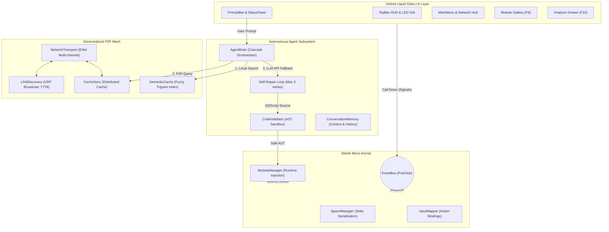
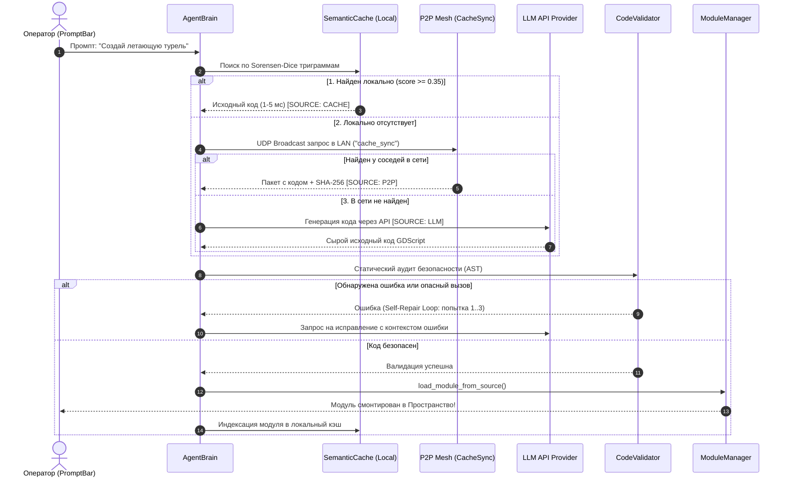

<div align="center">

# 🌐 UniCORE
### Universal Autonomous Runtime & Self-Synthesizing Modular Cyber-Engine

[](https://godotengine.org)
[](https://docs.godotengine.org)
[](LICENSE)
[-00E673?style=flat-square&logo=checkmarx&logoColor=white)](tests/)
[](ARCHITECTURE.md)
[](core/net/)

*Открытая расширяемая 3D-среда на Godot 4 со встроенным автономным ИИ-Агентом, децентрализованным семантическим P2P-кэшем и интерфейсом в эстетике Detroit Liquid Glass.*

[Ключевые возможности](#-ключевые-возможности) • [Архитектура](#-архитектура-системы) • [Быстрый старт](#-быстрый-старт) • [Управление](#-управление-и-горячие-клавиши) • [Тестирование](#-автоматическое-тестирование) • [Вклад в проект](#-руководство-по-вкладу-contributing)

</div>

---

## ⚡ Ключевые возможности

* 🧠 **Автономный рантайм-синтез и Self-Repair Loop**:
  * Синтез, валидация и горячее монтирование GDScript-модулей в реальном времени без перезапуска сцены.
  * 3-ступенчатый цикл самодиагностики: ошибки синтаксиса или компиляции автоматически перехватываются и исправляются Агентом на лету (`Self-Repair Loop`).
  * Контекстная память диалога (`ConversationMemory`) с динамическим обогащением промпта активными модулями.

* ⚡ **Децентрализованный Семантический Кэш (1–5 мс)**:
  * Мгновенный поиск готовых модулей по алгоритму нечеткого n-грамм сходства Серенсена — Дайса без расхода токенов LLM.
  * Взвешенное ранжирование (ключевые слова + теги + n-граммы описания + динамическая репутация модуля).

* 🌐 **Бессерверная P2P-сеть и LAN Discovery**:
  * Автоматическое обнаружение узлов в локальной сети через бессерверный UDP Broadcast (порт 7778).
  * Многоканальный ENet-транспорт (`module_share`, `space_sync`, `cache_sync`, `heartbeat`).
  * Двухфазный защищенный протокол P2P-обмена модулями с криптографической проверкой SHA-256.

* 🛡️ **Песочница безопасности (CodeValidator Sandbox)**:
  * Статический анализатор GDScript AST блокирует деструктивные вызовы движка (`OS.execute`, системный доступ к диску, шелл-инъекции) до компиляции.
  * Жесткий лимит размера сетевых пакетов (64 KB) для защиты от переполнения буфера.

* 💎 **Detroit: Become Human Liquid Glass UI**:
  * Процедурный матовый стеклянный интерфейс (шейдеры `liquid_glass`, неоновая окантовка, LED-индикаторы).
  * Интерактивная многослойная Сфера Агента (`Fluid Detroit Orb`), отражающая когнитивные состояния (Idle, Listening, Thinking, Error) и реагирующая на мыслительную активность.
  * Встроенный графический диспетчер биндов клавиш (`InputMapper`) с перехватом конфликтов в рантайме.

---

## 🏛 Архитектура системы

UniCORE построен по принципу **стерильного микроядра** с полным декуплингом слоев. Модули, сеть, агент и пользовательский интерфейс взаимодействуют исключительно через сигналы и глобальную шину событий.



### 4-шаговый каскад разрешения модулей



---

## 🚀 Быстрый старт

### Системные требования
* **Godot Engine**: `v4.0.stable` (Standard Edition, 64-bit).
* **ОС**: Windows 10/11, Linux (x86_64).
* **LLM API (Опционально)**: Ключ Google Gemini, OpenAI, OpenRouter или запущенная локально Ollama. *Без API система полноценно работает в оффлайн-режиме за счет встроенного семантического кэша и предустановленных модулей.*

### 1. Клонирование репозитория
```bash
git clone https://github.com/Amirrima37/UniCORE.git
cd UniCORE
```

### 2. Запуск через редактор Godot
1. Запустите **Godot Engine 4.0**.
2. Нажмите кнопку **Import** (Импорт) и выберите файл `project.godot`.
3. Нажмите **Edit**, затем клавишу **F5** (Запуск проекта).

### 3. Запуск через командную строку (CLI)
```powershell
# Обычный запуск приложения
& "C:\Godot\godot.exe" --path "c:\dev\UniCORE"

# Быстрая проверка синтаксиса без открытия графического окна
& "C:\Godot\godot.exe" --headless --path "c:\dev\UniCORE" --check-only

# Запуск полного сьюта модульных и интеграционных тестов
& "C:\Godot\Godot_v4.0-stable_win64_console.exe" --headless --path "c:\dev\UniCORE" -s res://tests/test_runner.gd
```

### 4. Настройка LLM-провайдера
При первом запуске нажмите `Esc` -> перейдите во вкладку **«Настройки»** -> секция **«Интеллект Ассистента (LLM)»** и укажите ваш API-ключ или локальный адрес Ollama (`http://localhost:11434/v1`). Настройки сохраняются локально в `user://settings.json`.

---

## 🎮 Управление и горячие клавиши

Все комбинации клавиш настраиваются в реальном времени через интерфейс `InputMapper` (`Esc` -> «Настройки» -> «Назначение клавиш»).

### 3D Навигация в Пространстве
| Клавиша / Ввод | Действие | Описание |
| :--- | :--- | :--- |
| `W`, `A`, `S`, `D` | Перемещение | Горизонтальное движение камеры/аватара |
| `Space` | Полет вверх | Вертикальный подъем в режиме свободного полета |
| `Ctrl` / `C` | Спуск вниз | Вертикальный спуск |
| `Shift` *(удержание)* | Турбо-режим | Ускорение полета в 2.5 раза |
| `Движение мыши` | Обзор камеры | Вращение камеры от первого лица (Pitch / Yaw) |

### Системный интерфейс и Оболочка
| Клавиша | Функция | Действие |
| :--- | :--- | :--- |
| `Esc` | Главное меню | Системный хаб: Пространства, Настройки, Сеть |
| `Enter` / `T` | Строка команд | Фокус на Detroit PromptBar для ввода запросов Агенту |
| `F9` | Галерея модулей | Картотека активных и библиотечных модулей |
| `F10` | Инспектор кода | Выдвижная панель диагностики CyberLife и просмотр исходников |
| `F11` | Полный экран | Переключение оконного / полноэкранного режима |

---

## 🧪 Автоматическое тестирование

Проект следует методологии **TDAID (Test-Driven AI Development)**. Любая подсистема покрывается автономными модульными тестами в директории `tests/`.

```powershell
& "C:\Godot\Godot_v4.0-stable_win64_console.exe" --headless --path c:\dev\UniCORE -s res://tests/test_runner.gd
```

* **Текущее покрытие:** 18 из 18 тестовых сьютов (100% PASS).
* **Проверяемые подсистемы:** Семантический кэш, P2P CacheSync, сетевой транспорт ENet, песочница CodeValidator, оверлей Fluid Orb, диспетчер InputMapper, сериализация пространств SpaceManager, экраны Boot & Welcome.

---

## 🤝 Руководство по вкладу (Contributing)

Мы приветствуем совместную разработку и Pull Request'ы!

### Архитектурный регламент:
1. **Строгая статическая типизация (Strict GDScript 2.0)**:
   * Все переменные, параметры функций и возвращаемые значения обязаны иметь явный тип (`var count: int = 0`, `func process_event(data: Dictionary) -> bool:`).
2. **Закон архитектуры: «Call Down, Signal Up»**:
   * Вызовы методов идут строго сверху вниз по дереву нод (`parent -> child`).
   * Оповещения о событиях — строго снизу вверх через сигналы или глобальный `EventBus`.
3. **Разделение зон ответственности**:
   * `res://ui/` — дизайн-система, шейдеры, визуальные элементы.
   * `res://core/` и `res://agent/` — стерильное ядро, сетевой стек, LLM-интеграция, валидатор.
4. **Стандарт коммитов**:
   * Используйте формат **Conventional Commits**: `feat(scope): ...`, `fix(scope): ...`, `test(scope): ...`, `docs: ...`.

---

## 📄 Лицензия

Проект распространяется под открытой лицензией [MIT License](LICENSE).
Copyright (c) 2026 Amirrima37 & UniCORE Contributors.
