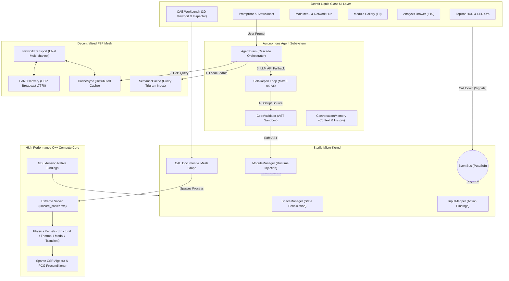

<div align="center">

# 🌐 UniCORE
### Universal Autonomous Runtime, Self-Synthesizing Modular Cyber-Engine & High-Performance CAE

[](https://godotengine.org)
[](native/)
[](requirements.txt)
[](https://docs.godotengine.org)
[](LICENSE)
[-00E673?style=flat-square&logo=checkmarx&logoColor=white)](tests/)
[](ARCHITECTURE.md)
[](core/net/)

*Открытая расширяемая 3D-платформа на Godot 4.7.2 со встроенным автономным ИИ-Агентом, высокопроизводительным физическим C++ ядром (Extreme Calculation Engine), инженерным CAE-воркбенчем, P2P-сетью и интерфейсом в эстетике Detroit Liquid Glass.*

[Ключевые возможности](#-ключевые-возможности) • [Архитектура](#-архитектура-системы) • [Быстрый старт с GitHub](#-быстрый-старт-с-github) • [Extreme C++ Solver](#-extreme-calculation-mode-c) • [Управление](#-управление-и-горячие-клавиши) • [Тестирование](#-автоматическое-тестирование) • [Лицензии](#-лицензия)

</div>

---

## ⚡ Ключевые возможности

* 🚀 **Высокопроизводительный C++ Extreme Calculation Engine & Multiphysics Kernels**:
  * **Автономный C++17 решатель** (`bin/unicore_solver.exe`) с поддержкой многопоточности OpenMP, запускаемый независимо от графического интерфейса Godot.
  * **Нативные FP64 ядра физического расчета** (`native/src/kernels/`):
    * `structural_solver.hpp` — статический прочностной расчет (HEX8 и TET4 элементы).
    * `thermal_solver.hpp` — стационарная и нестационарная теплопроводность с учетом конвекции и нелинейного радиационного излучения Стефана — Больцмана.
    * `modal_solver.hpp` — расчет собственных форм и частот колебаний.
    * `transient_structural.hpp` — динамический анализ во временной области (интегрирование Ньюмарка).
    * `gravity_solver.hpp`, `molecular_solver.hpp`, `nuclear_solver.hpp`, `quantum_solver.hpp` — расширенные физические симуляторы.
  * **Разреженная линейная алгебра** (`native/src/math/`): формат сжатых строк (CSR), параллельный метод предобусловленных сопряженных градиентов (PCG), диагональное и симметричное предобусловливание.
  * **Отказоустойчивость и безопасность**: чекпоинты состояния (`checkpoint.ucstate`), горячий рестарт нестационарных процессов, строгие бюджеты оперативной памяти (`--memory-mb`), атомарная запись результатов (`status.json`).

* 📐 **Инженерный CAE / CAD воркбенч (`core/cae/` и `ui/cae/`)**:
  * Полноценный конечно-элементный пайплайн в реальном времени: импорт геометрии -> назначение материалов -> структурированная (HEX8) и неструктурированная (TET4) дискретизация -> задание граничных условий и нагрузок -> расчет -> визуализация полей напряжений и температур.
  * Интеграция с эталонными инженерными библиотеками: **Gmsh 4.15.2** (сеточный генератор), **CalculiX 2.23** (промышленный FEA), **Open CASCADE Technology (OCCT) 7.8.1** (CAD B-Rep ядро).

* 🧠 **Автономный рантайм-синтез и Self-Repair Loop**:
  * Синтез, валидация и горячее монтирование GDScript-модулей в реальном времени без перезапуска сцены.
  * 3-ступенчатый цикл самодиагностики: ошибки синтаксиса или компиляции автоматически перехватываются и исправляются Агентом на лету (`Self-Repair Loop`).
  * Контекстная память диалога (`ConversationMemory`) с динамическим обогащением промпта активными модулями.

* ⚡ **Децентрализованный Семантический Кэш (1–5 мс)**:
  * Мгновенный поиск готовых модулей по алгоритму нечеткого n-грамм сходства Серенсена — Дайса без расхода токенов LLM.
  * Взвешенное ранжирование (ключевые слова + теги + n-граммы описания + динамическая репутация модуля).

* 🌐 **Бессерверная P2P-сеть и LAN Discovery**:
  * Автоматическое обнаружение узлов в локальной сети через бессерверный UDP Broadcast (порт 7778).
  * Многоканальный ENet-транспорт (`module_share`, `space_sync`, `cache_sync`, `heartbeat`).
  * Двухфазный защищенный протокол P2P-обмена модулями с криптографической проверкой SHA-256.

* 🛡️ **Песочница безопасности (CodeValidator Sandbox)**:
  * Статический анализатор GDScript AST блокирует деструктивные вызовы движка (`OS.execute`, системный доступ к диску, шелл-инъекции) до компиляции.
  * Жесткий лимит размера сетевых пакетов (64 KB) для защиты от переполнения буфера.

* 💎 **Detroit: Become Human Liquid Glass UI**:
  * Процедурный матовый стеклянный интерфейс (шейдеры `liquid_glass`, неоновая окантовка, LED-индикаторы).
  * Интерактивная многослойная Сфера Агента (`Fluid Detroit Orb`), отражающая когнитивные состояния (Idle, Listening, Thinking, Error) и реагирующая на мыслительную активность.
  * Встроенный графический диспетчер биндов клавиш (`InputMapper`) с перехватом конфликтов в рантайме.

---

## 🏛 Архитектура системы

UniCORE построен по принципу **стерильного микроядра** с полным декуплингом слоев. Модули, сеть, агент, пользовательский интерфейс и физические солверы взаимодействуют исключительно через сигналы, шину событий и строгие файловые/памяти контракты.



---

## 🚀 Быстрый старт с GitHub

### Системные требования
* **Godot Engine**: `v4.7.2` (Standard Edition, 64-bit).
* **Python**: `3.10+` (x86_64).
* **C++ компилятор**: MinGW-w64 (GCC 13+) с поддержкой OpenMP или MSVC 2022 (C++17).
* **ОС**: Windows 10/11 (x86_64), Linux (x86_64).
* **Опционально (для глубокого CAD/FEA)**: Gmsh 4.15.2, CalculiX 2.23, Open CASCADE SDK 7.8.1.
* **LLM API (Опционально)**: Ключ Google Gemini, OpenAI, OpenRouter или локальная Ollama. *Без API система полностью функциональна оффлайн за счет семантического кэша и встроенных модулей.*

---

### Шаг 1. Клонирование репозитория
```bash
git clone https://github.com/Amirrima37/UniCORE.git
cd UniCORE
```

### Шаг 2. Установка зависимостей Python
Установите библиотеки для работы с матричной алгеброй, валидации CAE и API сеток:
```bash
pip install -r requirements.txt
```

### Шаг 3. Сборка C++ Extreme Calculation Solver
Для работы автономного решателя скомпилируйте `unicore_solver.exe`. Скрипт сборки автоматически обнаружит установленный компилятор MinGW/GCC:

```powershell
powershell -ExecutionPolicy Bypass -File native/extreme/build.ps1
```

*(Опционально: доступна отладочная сборка с флагом `-Debug`, либо сборка без OpenMP с флагом `-NoOpenMP`)*.

При использовании **CMake**:
```bash
cmake -B build native/extreme -DCMAKE_BUILD_TYPE=Release
cmake --build build --config Release
```

Скомпилированный бинарный файл будет помещен в `bin/unicore_solver.exe`.

### Шаг 4. Запуск в Godot Engine
1. Запустите **Godot Engine 4.7.2**.
2. Нажмите **Import** и укажите файл `project.godot` из корня репозитория.
3. Нажмите **Edit**, затем клавишу **F5** (или кнопку «Играть»).

#### Запуск из терминала (CLI):
```powershell
# Запуск графического интерфейса
& "C:\Godot\godot.exe" --path .

# Быстрая проверка синтаксиса без открытия окна
& "C:\Godot\godot.exe" --headless --path . --check-only
```

---

## ⚡ Extreme Calculation Mode (C++)

В UniCORE встроен мощный автономный решатель конечно-элементных задач (`native/extreme/main.cpp`), использующий нативные ядра (`native/src/kernels/`).

### Особенности:
* **Формат задания (`.ucjob`)**: простой ASCII-формат SI-единиц с валидацией топологии и связности.
* **OpenMP-параллелизация**: масштабирование на все доступные физические ядра процессора.
* **Управление памятью**: жесткий контроль лимита RAM (`--memory-mb`), предотвращающий OOM-сбои системы.
* **Чекпоинты и сохранение**: промежуточные состояния сохраняются в `checkpoint.ucstate` с возможностью перезапуска с прерванного шага.

### Запуск решателя из командной строки:
```powershell
# Базовый запуск статического или теплового анализа
bin/unicore_solver.exe --job model.ucjob --threads 4 --memory-mb 2048 --output results

# Запуск с паузой после 5-го временного шага
bin/unicore_solver.exe --job model.ucjob --threads 4 --output results --pause-after 5

# Горячий перезапуск расчета с чекпоинта
bin/unicore_solver.exe --job model.ucjob --threads 4 --restart results/checkpoint.ucstate --output results
```

---

## 🎮 Управление и горячие клавиши

Все комбинации клавиш настраиваются в реальном времени через интерфейс `InputMapper` (`Esc` -> «Настройки» -> «Назначение клавиш»).

### 3D Навигация в Пространстве
| Клавиша / Ввод | Действие | Описание |
| :--- | :--- | :--- |
| `W`, `A`, `S`, `D` | Перемещение | Горизонтальное движение камеры/аватара |
| `Space` | Полет вверх | Вертикальный подъем в режиме свободного полета |
| `Ctrl` / `C` | Спуск вниз | Вертикальный спуск |
| `Shift` *(удержание)* | Турбо-режим | Ускорение полета в 2.5 раза |
| `Движение мыши` | Обзор камеры | Вращение камеры от первого лица (Pitch / Yaw) |

### Системный интерфейс и Оболочка
| Клавиша | Функция | Действие |
| :--- | :--- | :--- |
| `Esc` | Главное меню | Системный хаб: Пространства, Настройки, Сеть |
| `Enter` / `T` | Строка команд | Фокус на Detroit PromptBar для ввода запросов Агенту |
| `F9` | Галерея модулей | Картотека активных и библиотечных модулей |
| `F10` | Инспектор кода | Выдвижная панель диагностики CyberLife и просмотр исходников |
| `F11` | Полный экран | Переключение оконного / полноэкранного режима |

---

## 🧪 Автоматическое тестирование

Проект следует методологии **TDAID (Test-Driven AI Development)**.

### 1. Тесты Godot (модульные и интеграционные)
```powershell
& "C:\Godot\godot.exe" --headless --path . -s res://tests/test_runner.gd
```
* **Покрытие:** 18 из 18 тестовых сьютов (100% PASS).
* **Проверяемые компоненты:** Семантический кэш, P2P CacheSync, сетевой транспорт ENet, песочница CodeValidator, оверлей Fluid Orb, диспетчер InputMapper, сериализация пространств SpaceManager.

### 2. Тесты C++ физических ядер и Extreme-режима
При сборке через CMake тесты запускаются с помощью `ctest`:
```bash
ctest --test-dir build --output-on-failure
```
Проверяются: `parallel_assembly_test`, `sparse_preconditioner_test`, `modal_test`, `dynamics_test`, `structural_solver_test`, `thermal_radiation_test`.

### 3. Тесты валидации CAE на Python
```powershell
python tests/cad24_native.py
python tests/cad24_history.py
```

---

## 🤝 Руководство по вкладу (Contributing)

Мы приветствуем совместную разработку и Pull Request'ы!

### Архитектурный регламент:
1. **Строгая статическая типизация (Strict GDScript 2.0)**:
   * Все переменные, параметры функций и возвращаемые значения обязаны иметь явный тип (`var count: int = 0`, `func process_event(data: Dictionary) -> bool:`).
2. **C++17 стандарт для нативных модулей**:
   * Чистый, безопасный C++17 без неопределенного поведения, поддержка OpenMP, строгая проверка указателей и границ массивов.
3. **Закон архитектуры: «Call Down, Signal Up»**:
   * Вызовы методов идут строго сверху вниз по дереву нод (`parent -> child`).
   * Оповещения о событиях — строго снизу вверх через сигналы или глобальный `EventBus`.
4. **Стандарт коммитов**:
   * Используйте формат **Conventional Commits**: `feat(scope): ...`, `fix(scope): ...`, `test(scope): ...`, `docs: ...`.

---

## 📄 Лицензия

Проект распространяется под открытой лицензией [MIT License](LICENSE).  
Copyright (c) 2026 Amirrima37 & UniCORE Contributors.

### Сторонние инженерные инструменты и лицензии
UniCORE может опционально взаимодействовать с внешними инженерными инструментами. Их лицензии независимы от лицензии UniCORE:

| Компонент | Версия проекта | Лицензия | Назначение |
|---|---:|---|---|
| Godot Engine | 4.7.2 | MIT License | 3D-движок, интерфейс и рантайм |
| Gmsh | 4.15.2 | GNU GPL v2+ (Gmsh exception) | Генератор КЭ-сеток и B-Rep интерфейс |
| CalculiX | 2.23 | GNU GPL v2 | Внешний промышленный FEA-решатель |
| Open CASCADE (OCCT) | 7.8.1 | LGPL-2.1 with exception | Геометрическое CAD-ядро |
| godot-cpp | 4.7 | MIT License | C++ биндинги GDExtension |
